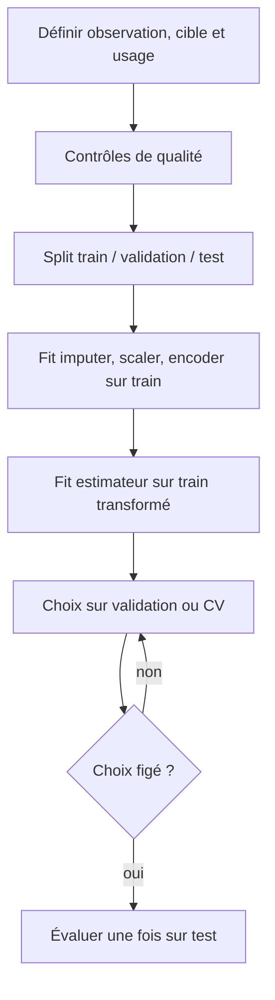
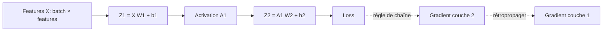
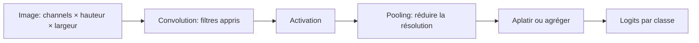
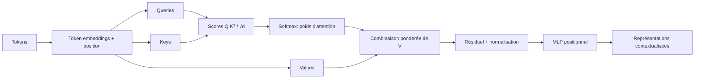
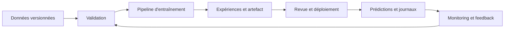

# Schémas originaux du parcours

Les diagrammes sont écrits en Mermaid pour pouvoir être révisés avec le cours et rester lisibles sans image binaire. Ils sont simplifiés pour l’enseignement ; les axes ou paramètres absents sont explicités dans les leçons.

## Préparation et séparation



## Un pas de gradient

```mermaid
flowchart LR
  A[Paramètres w,b] --> B[Prédiction y_hat = wx + b]
  B --> C[Loss J(w,b)]
  C --> D[Gradient dJ/dw, dJ/db]
  D --> E[Soustraire learning_rate × gradient]
  E --> A
```

Le gradient donne la pente de la loss dans l’espace des paramètres. Un pas trop grand peut passer de l’autre côté du minimum ; le notebook trace la loss pour le cas étudié.

## Forward pass et rétropropagation



## CNN



## Transformer encoder simplifié



Cette vue omet les têtes multiples, masques, couches répétées et détails de normalisation ; le schéma décrit la circulation d’information, pas un modèle complet.

## Cycle MLOps



Le feedback peut être différé ; surveiller des entrées ne remplace pas la mesure de performance quand les vrais labels arrivent.
