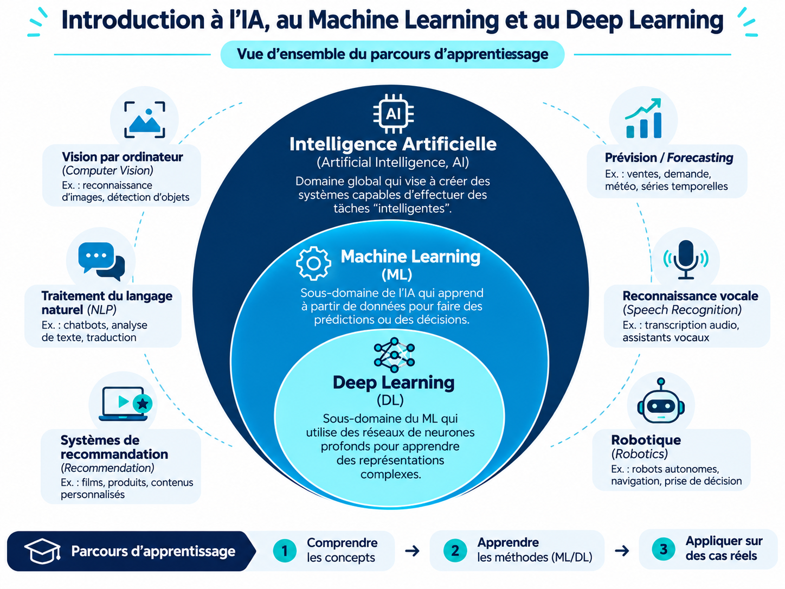
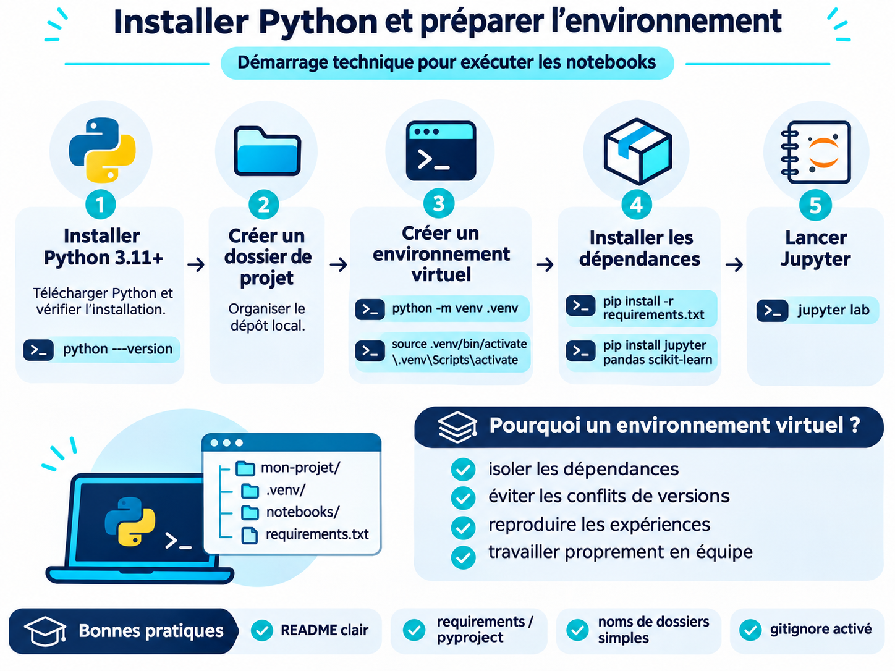
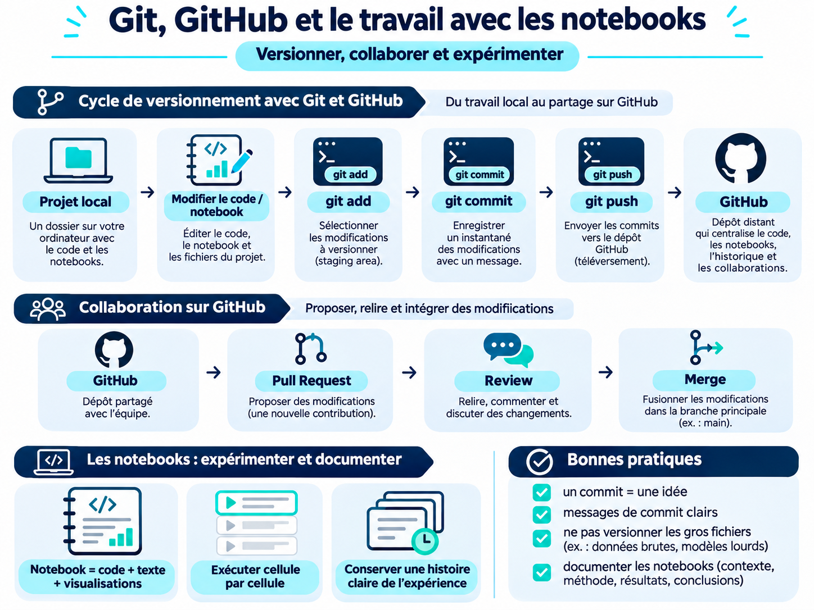
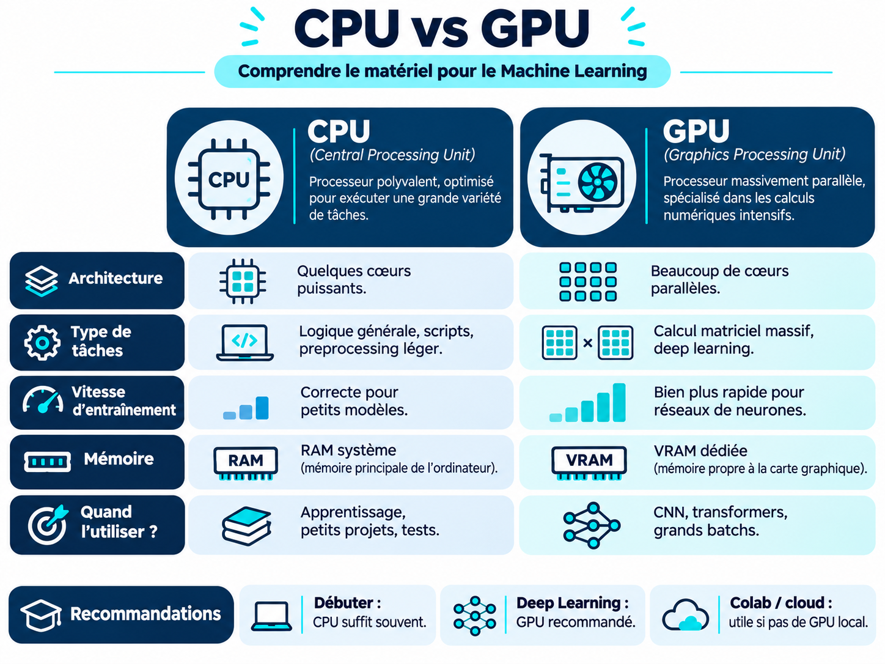
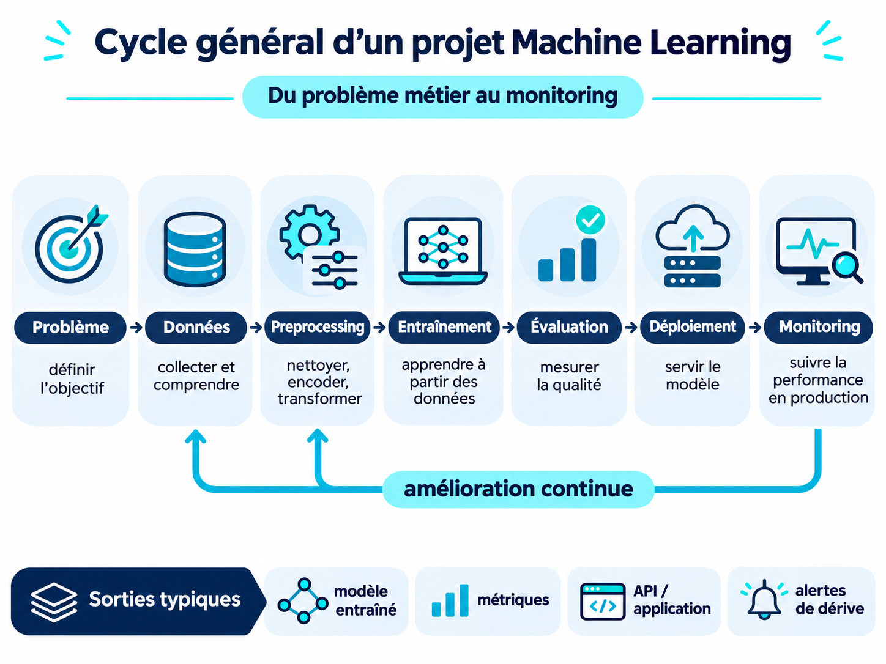
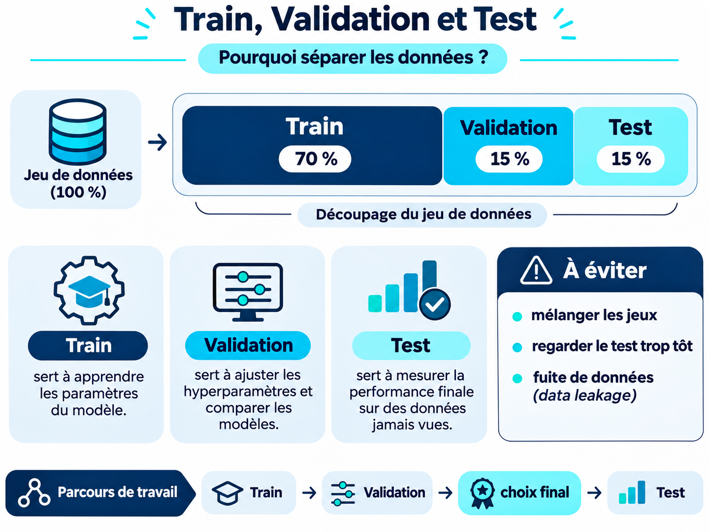
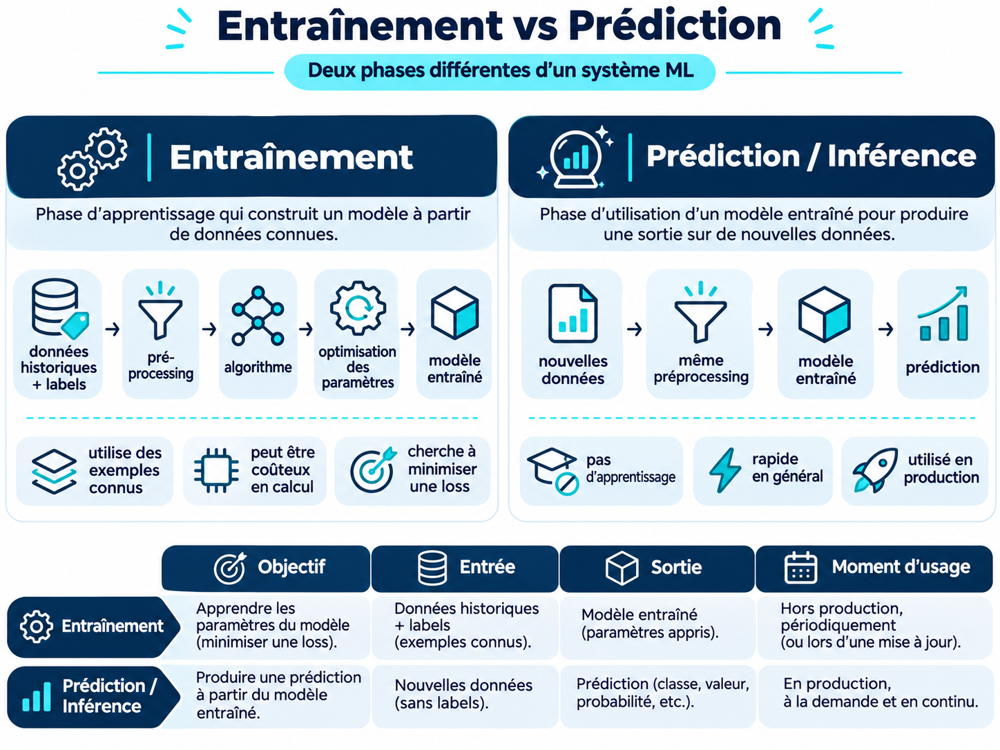

# Module 00 — Démarrer sans friction

**Niveau :** débutant · **Durée :** 2–3 h · **Prérequis :** aucun au-delà d’un ordinateur personnel.

## Objectifs

- Distinguer AI, Machine Learning et Deep Learning par leur relation, pas par des slogans.
- Créer un environnement Python isolé et lancer un notebook local ou dans Colab.
- Utiliser `git status`, une branche et un commit pour retrouver son travail.
- Choisir CPU ou GPU selon le coût pratique de l’expérience.
- Suivre un projet ML de la collecte à la surveillance et distinguer ce parcours d’un objet `Pipeline` scikit-learn.

## Concepts

Un système de Machine Learning ajuste des paramètres à partir d’exemples pour une tâche définie. Deep Learning désigne une famille de modèles fondés sur des réseaux de neurones à plusieurs couches ; ce n’est pas synonyme de toute l’AI. Data Science couvre également la collecte, l’exploration, la communication et la décision à partir des données.

## Supports visuels

Les images de ce dossier servent de repères avant l’exécution des notebooks. Elles sont utilisées comme supports pédagogiques, tandis que les figures produites par le code restent reproductibles dans les notebooks.

## Activité

1. Suivre [le guide d’installation](../../docs/getting-started.md).
2. Cloner le dépôt et créer une branche d’essai.
3. Ouvrir un notebook, exécuter une cellule, puis redémarrer le noyau et tout réexécuter.
4. Exécuter [Le pipeline ML : de la question à la surveillance](01_ml_pipeline.ipynb). Les deux schémas originaux montrent le cycle du projet et les rôles de train, validation et test ; l’exemple synthétique fonctionne sur CPU.
5. Noter le système d’exploitation, la version Python et si un GPU est disponible.

## Vocabulaire et limites

Une **feature** est une entrée connue au moment de la prédiction ; le **label** ou **target** est ce que l’on cherche à prédire. Un score élevé sur les exemples d’entraînement ne garantit pas le comportement sur de nouvelles données. Aucun matériel GPU n’est nécessaire pour le parcours initial.

**À vérifier :** vous pouvez reproduire l’environnement et citer la commande qui ouvre votre premier notebook.
